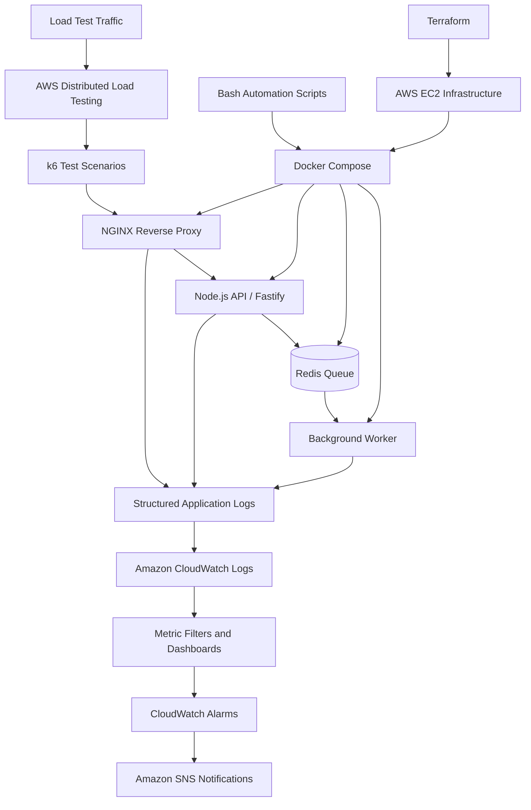

# FlashScale — AIOps Load Testing Platform

  
  
  
  
  
  
  
  
  
  

FlashScale is a cloud-based AIOps and load-testing project built to explore application behavior under heavy traffic, improve operational visibility, and investigate controlled failure scenarios.

The project combines a containerized application, load generation, centralized logging, cloud monitoring, alerting, and Bash-based operational automation in an AWS environment.

The recorded load-test demonstration reached 168K load. The exact meaning of this figure depends on the metric used in the test report; it should not be interpreted as concurrent users or requests per second without supporting measurements.

## Project Goal

The main goal of FlashScale is to go beyond generating traffic and explore what happens inside an application under load.

The project focuses on:

- Evaluating application behavior during controlled load tests.
- Observing request volume, response codes, latency, and queue activity.
- Exploring different failure patterns through controlled AIOps scenarios.
- Connecting application logs and metrics with cloud monitoring and alerts.
- Automating repetitive operational tasks using Bash scripts.
- Practicing containerization, cloud infrastructure, observability, and reliability engineering.

## Architecture

## What I Worked On

### 1. Application and Containerization

- Worked with a Node.js API built using Fastify.
- Integrated Redis for queue management and background order processing.
- Configured a separate worker service to process queued jobs.
- Used Docker to package application components.
- Used Docker Compose to manage multiple services.
- Configured a custom Docker bridge network and persistent Redis storage.
- Set up NGINX as a reverse proxy for incoming HTTP traffic.
- Worked on connection handling, keep-alive settings, and structured access logs.

### 2. Load Testing

- Used k6 to define controlled traffic scenarios.
- Prepared load-testing assets for AWS Distributed Load Testing.
- Explored ramping virtual-user workloads.
- Worked with test scenarios involving health checks, product reads, and order submissions.
- Demonstrated a recorded load-test result reaching 168K load.

The result represents the observed test metric, not a universal performance guarantee. Actual capacity depends on workload characteristics, test duration, infrastructure, and load-generator limits.

### 3. Monitoring and Observability

- Configured Amazon CloudWatch Logs for centralized log collection.
- Worked with structured application events.
- Added custom metric filters and dashboard configuration.
- Worked with request-volume and AIOps-related monitoring signals.
- Configured CloudWatch alarms to detect configured thresholds.
- Integrated Amazon SNS to support email notifications.

The monitoring workflow helps connect application activity with operational signals that can be investigated during testing.

### 4. AIOps and Incident Simulation

I implemented controlled scenarios to explore different operational symptoms, including:

- Increased request latency.
- HTTP 5xx error spikes.
- Background-worker bottlenecks.
- Queue-depth growth and backlog.
- Unusual log events and anomaly-related signals.

Bash scripts support scenario execution, status checks, log queries, and reset operations.

These scenarios provide a practical foundation for studying AIOps workflows. They do not, by themselves, imply that a fully autonomous AI remediation engine has been implemented.

### 5. Bash Automation

I wrote Bash scripts to reduce repetitive operational work and make common tasks easier to execute consistently.

The scripts cover areas such as:

- Deployment and application status checks.
- Load-test asset packaging.
- CloudWatch log-group and monitoring setup.
- AIOps scenario execution and reset.
- Log queries and operational checks.
- SNS alert configuration and testing.
- Periodic low-volume test traffic.
- Cleanup and removal of configured resources.

### 6. Infrastructure as Code

- Used Terraform to define a minimal EC2-based infrastructure configuration.
- Worked with AWS networking, security groups, IAM permissions, and instance-related configuration.
- Used AWS CLI for operational automation and cloud resource management.

## Tools and Technologies

| Category | Technologies |
|---|---|
| Cloud platform | AWS |
| Compute and networking | EC2, VPC, Security Groups |
| Identity and access | IAM |
| Application runtime | Node.js, JavaScript |
| API framework | Fastify |
| Queue and data services | Redis, ioredis |
| Reverse proxy | NGINX |
| Containerization | Docker, Docker Compose |
| Load testing | k6, AWS Distributed Load Testing |
| Logging and monitoring | Amazon CloudWatch, CloudWatch Logs |
| Metrics and alerting | CloudWatch Metric Filters, Dashboards, Alarms |
| Notifications | Amazon SNS |
| Infrastructure as Code | Terraform |
| Automation | Bash, AWS CLI, curl, jq |
| Version control | Git, GitHub |

## Challenges Faced and How I Addressed Them

### Challenge 1: Understanding Application Behavior Under Load

Generating traffic alone does not explain why an application slows down or starts returning errors.

What I did:

I worked on structured logging and monitoring signals covering request activity, response status, latency, queue depth, and worker-processing events. These signals provide more context when reviewing a load-test run.

### Challenge 2: Distinguishing Different Failure Patterns

High latency, 5xx responses, and growing queues can indicate different problems.

What I did:

I added controlled scenarios for latency, error spikes, worker bottlenecks, queue backlog, and unusual log activity. I connected the relevant operational signals with CloudWatch monitoring so that different symptoms could be investigated separately.

### Challenge 3: Repetitive Operational Tasks

Repeatedly running deployment, setup, monitoring, testing, and cleanup commands makes workflows harder to maintain.

What I did:

I wrote Bash scripts to standardize common operations and reduce manual steps, including status checks, load-test packaging, scenario execution, monitoring configuration, and cleanup.

### Challenge 4: Connecting Logs, Metrics, and Alerts

Application logs are useful, but operational signals become more actionable when they can be monitored and tied to configured thresholds.

What I did:

I worked with CloudWatch Logs, metric filters, dashboards, alarms, and SNS notifications to build a monitoring and alerting workflow.

## Key Results

- Demonstrated a load-test run reaching 168K load.
- Built a multi-service containerized application using Docker Compose.
- Integrated an API, Redis-backed queue, and background worker.
- Configured NGINX for reverse-proxy traffic handling.
- Prepared k6 and AWS Distributed Load Testing assets.
- Added CloudWatch-based logging, metrics, dashboards, and alerting.
- Implemented controlled AIOps scenarios for different failure patterns.
- Created Bash scripts to simplify recurring operational tasks.
- Defined an EC2-based infrastructure configuration using Terraform.

These results describe the work completed in the project; they are not a claim of production certification or guaranteed capacity on other environments.

## What I Learned

This project strengthened my practical understanding of:

- Containerization and multi-service application deployment.
- Reverse proxies and application traffic handling.
- Load-test design and workload interpretation.
- AWS infrastructure and networking.
- Structured logging and cloud observability.
- Metrics, alarms, and notification workflows.
- Redis queues and background processing.
- Bash automation and infrastructure management.
- Incident investigation and reliability engineering.

The most important lesson was that a load-test result is only one part of performance engineering. Understanding the behavior behind that result is equally important.

## Future Improvements

Potential next steps for FlashScale include:

- Adding deeper anomaly-detection methods and baseline comparisons.
- Generating automated load-test reports with latency percentiles and error rates.
- Expanding dashboards to compare workload profiles and test runs.
- Exploring automated remediation with explicit safety checks and approval controls.
- Adding CI/CD pipelines for automated build, validation, and deployment.
- Evaluating horizontal scaling and load balancing with an Application Load Balancer.
- Exploring Prometheus and Grafana for additional observability options.
- Improving resource utilization tracking and cost monitoring.
- Adding repeatable performance regression tests to the development workflow.

These are planned improvement areas, not claims that every feature is already implemented.

## About Me

I am Tanjim Ahmed Tomal, a Computer Engineering graduate focused on DevOps, Cloud Engineering, automation, and reliability-focused systems.

I built FlashScale as a hands-on project to bring application deployment, load testing, observability, and operational automation together in one environment.

LinkedIn: [Add your LinkedIn profile URL here]
