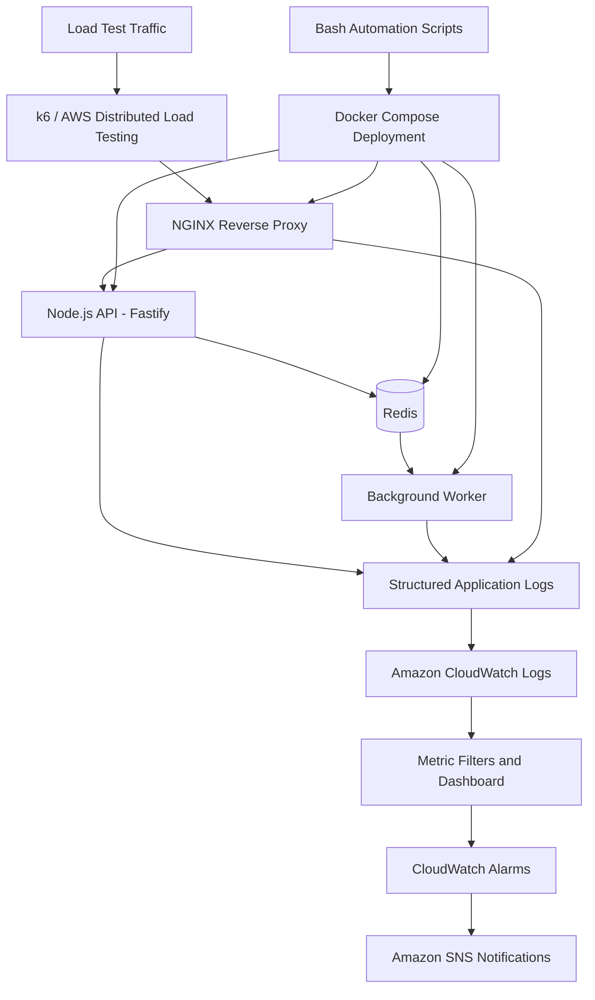

# FlashScale AIOps Load Testing Platform

**A hands-on AIOps and load-testing project focused on observing application behavior under heavy traffic, injecting controlled incidents, and making operational signals easier to investigate.**

Repository: [tanahmeeedsx/aiops-flashscale-app](https://github.com/tanahmeeedsx/aiops-flashscale-app)

## Project Overview

FlashScale combines a lightweight HTTP API, a background order-processing worker, Redis-backed queueing, an NGINX reverse proxy, and AWS observability components. The project was used to run a load test that reached **168K load in the recorded test run**. The figure refers to the load result observed in that run; it should not be interpreted as 168K concurrent users unless the test report explicitly identifies it that way.

The project emphasizes more than generating traffic: it also provides operational signals and controlled failure scenarios that make it possible to explore how an application behaves when latency, errors, or queue pressure increase.

## Architecture

## Main Work Delivered

- Built a containerized API and worker architecture using Node.js, Fastify, Redis, NGINX, Docker, and Docker Compose.
- Configured a dedicated Docker bridge network and persistent Redis storage.
- Tuned NGINX connection handling, keep-alive behavior, structured access logging, and reverse-proxy settings for load-test experiments.
- Added a k6 test template for mixed traffic, including health checks, product reads, and order submissions.
- Prepared assets for AWS Distributed Load Testing (DLT) to run ramping virtual-user scenarios.
- Added structured JSON events for requests, response status, latency, accepted orders, processed orders, queue depth, and AIOps scenario events.
- Integrated Amazon CloudWatch Logs, metric filters, dashboard generation, and request-volume alerting.
- Added Amazon SNS email-notification support for configured CloudWatch alarms.
- Implemented controlled AIOps scenarios for latency anomalies, 5xx error spikes, worker bottlenecks, queue backlog, and log anomalies.
- Wrote Bash scripts to reduce repetitive operations around deployment, status checks, load-test packaging, log-group creation, AIOps scenario activation/reset, alerts, and cleanup.
- Included a minimal Terraform configuration for provisioning an EC2-based environment and associated AWS resources.

## Tools and Technologies

| Area | Technologies |
|---|---|
| Application runtime | Node.js, JavaScript, Fastify |
| Queue and state | Redis, ioredis |
| Reverse proxy | NGINX |
| Containers | Docker, Docker Compose |
| Load testing | k6, AWS Distributed Load Testing |
| Monitoring and logs | Amazon CloudWatch, CloudWatch Logs, metric filters, dashboards |
| Alerting | Amazon CloudWatch Alarms, Amazon SNS |
| Cloud platform | Amazon EC2, IAM, VPC, Security Groups |
| Infrastructure as Code | Terraform |
| Automation | Bash, AWS CLI, curl, jq |
| Version control | Git, GitHub |

## Operational Challenges Addressed

### Making high-load behavior observable
A successful load run is only one part of the story. Structured logs and metrics were added to make request volume, response codes, latency, queue depth, and worker processing behavior easier to inspect.

### Investigating different failure patterns
Controlled scenarios make it possible to distinguish a slow API, elevated 5xx responses, a delayed background worker, queue accumulation, and unusual log events instead of treating every symptom as the same incident.

### Reducing repetitive operational work
Bash scripts package test assets and standardize recurring tasks such as deployment, status checks, scenario activation and reset, CloudWatch setup, and cleanup.

### Connecting application signals to alerts
CloudWatch metric filters, dashboards, alarms, and SNS notifications connect application events with operational visibility. Alert thresholds represent configured request-volume metrics and must not be confused with virtual-user counts.

## Load-Test Result

The recorded test run reached **168K load**, as demonstrated in the accompanying project video. Load-test outcomes depend on the metric being reported, workload profile, duration, client-side generator capacity, and the AWS instance configuration. This README therefore does not equate the result with concurrent users, requests per second, or requests per minute without the corresponding test report.

## Project Scope

This repository is a learning and demonstration project for AIOps concepts, load testing, containerized deployment, observability, and operational automation. It is not a claim of production certification or a guarantee that the same result will be reproduced on different infrastructure.

Detailed installation, deployment, and execution instructions are intentionally omitted from this project overview.

## Repository

[View the source repository on GitHub](https://github.com/tanahmeeedsx/aiops-flashscale-app)
